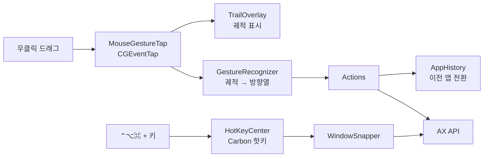

# MouseBetter

macOS 메뉴바에 상주하는 마우스 제스처·창 관리 앱입니다. BetterAndBetter 의 주요 기능을 대체하기 위해 만들었습니다.

- 우클릭을 누른 채 드래그하면 화면에 궤적이 그려지고, 모양에 따라 동작을 실행합니다.
- `⌃⌥⌘` 조합 단축키로 창을 절반 배치, 최대화, 모니터 이동, 전체 화면 전환합니다.
- Xcode 없이 Command Line Tools 와 Swift Package Manager 만으로 빌드합니다.

## 기능

### 마우스 제스처 (우클릭 드래그)

| 모양 | 방향 | 동작 |
| --- | --- | --- |
| ㄴ | ↓ → | 탭 닫기 (탭이 하나뿐이면 창 닫기) |
| | ↓ ← | 새로고침 |
| ㄱ | → ↓ | 이전 앱으로 전환 (⌘Tab 과 같은 효과) |
| \| | ↓ | 맨 아래로 스크롤 |
| \| | ↑ | 맨 위로 스크롤 |

움직이지 않고 우클릭만 하면 원래 우클릭(컨텍스트 메뉴)이 그대로 동작합니다.
인식에 성공하면 궤적이 초록색으로, 실패하면 회색으로 사라집니다.

### 창 단축키 (`⌃⌥⌘` + 키)

| 키 | 동작 |
| --- | --- |
| `←` `→` `↑` `↓` | 화면의 해당 방향 절반에 배치 |
| `P` | 다음 모니터로 이동 (크기와 상대 위치 유지, 모니터를 가득 채운 창은 대상 모니터도 가득 채움) |
| `M` | 최대 크기 토글 (다시 누르면 직전 크기로 복원) |
| `F` | macOS 전체 화면 토글 |
| `/` | MouseBetter 가 처음 조작하기 전의 크기와 위치로 복원 |
| `+` | 크기 키우기: 왼쪽 위 모서리를 고정한 채 가로를 모니터 폭까지 먼저 늘리고, 그다음 세로를 늘림 |
| `-` | 크기 줄이기: 왼쪽 위 모서리를 고정한 채 가로와 세로를 함께 줄임 |

메뉴바 아이콘을 누르면 현재 제공하는 제스처와 단축키 목록을 확인할 수 있습니다.

## 요구 사항

- macOS 14 이상 (Apple Silicon 에서 확인)
- Command Line Tools for Xcode (Swift 5.9 이상, 개발 환경은 Swift 6.4)
- 손쉬운 사용(Accessibility) 권한

## 설치

```bash
git clone git@github.com:ic4r/mouse-better.git
cd mouse-better
scripts/build.sh install
```

1. `~/Applications/MouseBetter.app` 이 설치되고 실행됩니다.
2. 손쉬운 사용 권한 요청 창이 뜨면 MouseBetter 를 허용합니다.
3. 권한을 허용하면 2초 안에 제스처가 활성화됩니다. 메뉴바 아이콘에서 권한 상태를 확인할 수 있습니다.

| 명령 | 설명 |
| --- | --- |
| `scripts/build.sh` | `build/MouseBetter.app` 생성 (ad-hoc 서명) |
| `scripts/build.sh install` | 설치, 손쉬운 사용 권한 초기화, 실행 |
| `scripts/build.sh test` | 제스처 인식기 단위 테스트 |
| `swift scripts/make-icon.swift` | 메뉴바와 같은 SF Symbol 로 앱 아이콘(`Resources/AppIcon.icns`) 재생성 |

> ad-hoc 서명은 빌드할 때마다 서명 해시가 바뀌므로, 다시 빌드하면 손쉬운 사용 권한을 다시 허용해야 합니다.

## 구조



| 파일 | 역할 |
| --- | --- |
| `Sources/GestureCore/GestureRecognizer.swift` | 궤적을 방향열로 변환하고 제스처에 매핑합니다. AppKit 의존이 없어 단위 테스트 대상입니다. |
| `Sources/MouseBetter/MouseGestureTap.swift` | 우클릭 이벤트를 가로채 제스처를 처리하고, 움직임이 없으면 클릭을 재전송합니다. |
| `Sources/MouseBetter/TrailOverlay.swift` | 모니터마다 투명 창을 띄워 궤적을 그립니다. |
| `Sources/MouseBetter/Actions.swift` | 제스처별 동작을 실행합니다. |
| `Sources/MouseBetter/AppHistory.swift` | 앱 활성화 순서를 기록해 이전 앱으로 전환합니다. |
| `Sources/MouseBetter/WindowSnapper.swift` | 창 명령과 단축키 매핑을 정의하고 실행합니다. |
| `Sources/MouseBetter/HotKeyCenter.swift` | Carbon 전역 단축키를 등록합니다. |
| `Sources/MouseBetter/AXHelpers.swift` | AX 속성 접근과 Cocoa/Quartz 좌표 변환을 담당합니다. |
| `Sources/MouseBetter/AppDelegate.swift` | 메뉴바 메뉴, 권한 대기, 로그인 시 실행을 처리합니다. |

### 동작 방식

| 동작 | 구현 | 이유 |
| --- | --- | --- |
| 탭 닫기, 새로고침 | AX 로 제스처를 그린 창을 앞으로 가져온 뒤 `⌘W`, `⌘R` 전송 | 탭 구조는 앱마다 달라 공통 객체 제어가 불가능합니다. 우클릭을 가로채므로 포커스를 먼저 옮겨야 다른 창의 탭이 닫히지 않습니다. |
| 이전 앱 전환 | 활성화 순서를 기록해 직전 앱을 직접 활성화 | 앱 전환기 UI 없이 즉시 전환되고 키 입력 타이밍에 영향을 받지 않습니다. |
| 스크롤 | 커서 아래 뷰에 픽셀 단위 휠 이벤트 전송 | 키보드 포커스가 입력란에 있어도 동작합니다. |
| 창 배치 | AX 로 창의 위치와 크기를 직접 설정 | 대응하는 단축키가 없어 객체 제어가 유일한 방법입니다. |

창 배치에는 두 가지 보정이 들어 있습니다.

- 다른 보조 기능 앱이 대상 앱의 `AXEnhancedUserInterface` 를 켜 두면 크기 변경이 비동기로 처리되어 모니터 간 이동이 무시됩니다. 조작하는 동안만 이 값을 끄고 원래대로 돌려놓습니다.
- 일부 모니터는 `visibleFrame` 에 드러나지 않는 상단 영역(예: 자동 숨김 메뉴바)에 창을 들이지 않습니다. 처음 밀려난 폭을 모니터별로 기억해 이후 계산에 반영합니다.

## 제스처·단축키 추가

- 제스처: `Gesture.bindings` 에 방향열과 제스처를 추가하고, `Gesture.title` 과 `Actions.perform` 에 이름과 동작을 추가합니다.
- 단축키: `WindowSnapper.bindings` 에 키와 명령을 추가하고, `Command.title` 과 `WindowSnapper.perform` 에 이름과 동작을 추가합니다.
- 메뉴바의 기능 목록은 두 매핑 표에서 자동으로 생성됩니다.

## 알려진 제약

- 컨텍스트 메뉴는 우클릭 버튼을 놓는 시점에 표시됩니다.
- 우클릭 드래그를 자체적으로 사용하는 앱(일부 게임, 그래픽 도구)과 충돌할 수 있습니다.
- 스크롤은 최대 400,000px 이동하므로, 그보다 긴 문서에서는 끝까지 도달하지 않을 수 있습니다.
- 최소 크기가 정해진 창은 절반 크기로 줄어들지 않을 수 있습니다.
- `/` 복원 기준은 앱을 다시 실행하면 초기화됩니다.
