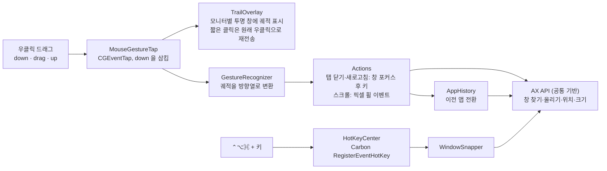
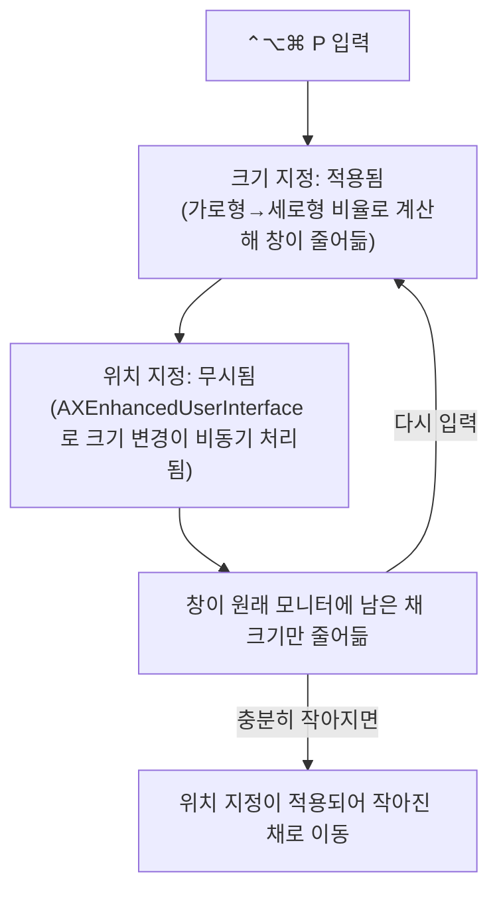

# MouseBetter 개발 문서

MouseBetter 의 개발 배경, 설계 결정, 문제 해결 기록, 검증 현황, 로드맵을 정리한 문서입니다.
기능과 설치 방법은 [README](../README.md), 버전별 변경 내용은 [CHANGELOG](../CHANGELOG.md) 를 참고합니다.

## 개요

MouseBetter 는 BetterAndBetter 를 대체하는 macOS 메뉴바 상주 앱이며, 마우스 제스처와 창 관리 단축키를 함께 제공합니다.

- 목적: 개인 업무 환경에서 BetterAndBetter 의 마우스 제스처와 창 정렬 기능을 대체합니다.
- 범위: 1차 개발에 마우스 제스처와 창 관리 단축키를 함께 포함했습니다. 두 기능은 손쉬운 사용(Accessibility) 권한과 AX API 기반 코드를 공유하므로, 나누어 개발하는 것보다 한 번에 개발하는 편이 비용이 적습니다.
- 범위 밖: 설정 UI, 코드 서명과 공증은 [로드맵](#로드맵)에서 다룹니다.
- 저장소: [ic4r/mouse-better](https://github.com/ic4r/mouse-better) (`main` 브랜치)

## 요구사항

우클릭을 누른 채로 그리는 동안 화면에 궤적을 표시하고, 버튼을 놓으면 인식한 제스처에 따라 동작을 실행합니다.
움직임 없이 우클릭만 한 경우에는 원래 우클릭(컨텍스트 메뉴)이 그대로 동작해야 합니다.

| 구분 | 입력 | 동작 |
| --- | --- | --- |
| 제스처 | 왼쪽으로 1자 (←) | 뒤로 가기 |
| 제스처 | 오른쪽으로 1자 (→) | 앞으로 가기 |
| 제스처 | ㄴ (↓ →) | 현재 탭 닫기. 탭이 하나뿐이면 창이 닫힙니다. |
| 제스처 | ↓ ← | 새로고침 |
| 제스처 | ㄱ (→ ↓) | 이전 앱으로 전환 (⌘Tab 과 같은 효과) |
| 제스처 | 아래로 1자 (↓) | 스크롤 최하단 |
| 제스처 | 위로 1자 (↑) | 스크롤 최상단 |
| 단축키 | ⌃⌥⌘ ← / → / ↑ / ↓ | 창을 화면의 해당 방향 절반에 배치 |
| 단축키 | ⌃⌥⌘ P | 창을 다음 모니터로 이동 (크기와 상대 위치 유지) |
| 단축키 | ⌃⌥⌘ M | 최대 크기 토글 (다시 누르면 직전 크기로 복원) |
| 단축키 | ⌃⌥⌘ F | macOS 전체 화면 토글 |
| 단축키 | ⌃⌥⌘ / | 창을 MouseBetter 가 처음 조작하기 전의 크기와 위치로 복원 |
| 단축키 | ⌃⌥⌘ + | 크기 키우기: 왼쪽 위 모서리를 고정한 채 가로를 모니터 폭까지 먼저 늘리고 그다음 세로를 늘림 |
| 단축키 | ⌃⌥⌘ - | 크기 줄이기: 왼쪽 위 모서리를 고정한 채 가로와 세로를 함께 줄임 |
| 단축키 | ⌃⌥⌘ G | 마우스 제스처 전체 켜기·끄기 (꺼지면 메뉴바 아이콘이 흐려짐) |
| 메뉴 | 메뉴바 아이콘 | 제공하는 제스처와 단축키 목록 표시 |
| 메뉴 | 〈앱〉에서 제스처 사용 안 함, 제스처 예외 앱 ▸ 앱 추가… | 우클릭 드래그를 직접 쓰는 앱을 예외로 등록·해제. 앱 추가는 파일 선택 창에서 `.app` 을 골라 등록. 기본 예외는 Roblox, iTerm |
| 앱 아이콘 | Finder, Dock | 메뉴바와 같은 `scribble.variable` 심볼을 쓴 아이콘 |

## 설계

동작마다 더 안정적인 방식을 골랐습니다. 탭은 키 전송, 창 배치는 AX 객체 제어, 스크롤은 휠 이벤트를 씁니다.

이벤트 탭, 키 합성, AX 제어는 모두 손쉬운 사용 권한 하나로 동작합니다.

| 동작 | 방식 | 선택 이유 |
| --- | --- | --- |
| 뒤로·앞으로 가기, 탭 닫기, 새로고침 | AX 로 제스처를 그린 창을 앞으로 올린 뒤 ⌘[, ⌘], ⌘W, ⌘R 전송 | 앱마다 탭 구조가 달라 AX 로 공통 처리가 불가능합니다. 뒤로·앞으로 가기는 Safari, Chrome, Finder 가 공통으로 지원하는 ⌘[, ⌘] 를 씁니다. 우클릭을 삼키므로 포커스를 먼저 옮기지 않으면 다른 창의 탭이 닫힙니다. |
| 이전 앱 전환 | 앱 활성화 순서를 기록해 직전 앱을 직접 활성화 | ⌘Tab 키를 합성하는 것보다 앱 전환기 UI 가 뜨지 않고 키 입력 타이밍에 영향을 받지 않습니다. 백그라운드 앱의 `activate()` 는 macOS 14 이후 무시될 수 있어 AX 의 `AXFrontmost` 도 함께 지정합니다. |
| 스크롤 최상단, 최하단 | 픽셀 단위 휠 이벤트 8회 (회당 50,000px) | 키보드 포커스와 무관하게 커서 아래 뷰가 반응합니다. ⌘↓ 는 입력란에 포커스가 있으면 커서만 이동합니다. |
| 창 배치 | AX 로 포커스된 창의 위치와 크기를 직접 설정 | 대응하는 단축키가 없으므로 객체 제어가 유일한 방법입니다. 메뉴바와 Dock 을 제외한 가용 영역을 기준으로 계산합니다. |
| 단축키 수신 | Carbon RegisterEventHotKey | 등록한 조합만 가로채므로 다른 키 입력에 영향이 없고, 손쉬운 사용 권한 없이도 동작합니다. |

### 제스처 인식

1. 궤적을 8px 간격으로 샘플링하여 직전 지점 대비 우세한 축으로 상하좌우 방향을 정합니다.
2. 같은 방향이 이어지면 하나의 구간으로 합치고 길이를 누적합니다.
3. 40px 보다 짧은 구간(손떨림)은 버리고, 버린 뒤 이웃한 같은 방향을 다시 합칩니다.
4. 최종 방향열을 `Gesture.bindings` 매핑 표와 비교합니다. 메뉴바의 기능 목록도 이 표에서 생성합니다.

우클릭 후 12px 이상 움직여야 제스처로 판정하며, 그보다 적게 움직이면 삼켰던 우클릭 down/up 을 다시 보냅니다.
재전송한 이벤트는 `eventSourceUserData` 필드에 표식(`0x4D424554`)을 남겨 이벤트 탭이 다시 가로채지 않게 합니다.

### 제스처 끄기와 예외 앱

특정 앱(Roblox 처럼 우클릭 드래그로 시점을 돌리는 게임, iTerm)에서는 제스처가 우클릭을 가로채면 안 됩니다.
세 가지 방식을 검토했고, 앱별 예외를 기본으로 두고 단축키 토글을 보조로 두었습니다.

| 방식 | 판단 |
| --- | --- |
| 앱별 예외 | 채택. 한 번 등록하면 자동으로 적용되어 끄고 켜는 것을 잊을 일이 없습니다. |
| 단축키 토글 (`⌃⌥⌘ G`) | 채택. 기존 창 단축키와 같은 체계이고 부작용이 없습니다. |
| 가운데 버튼 더블클릭 토글 | 기각. 그대로 통과시키면 브라우저에서 링크가 새 탭에 두 번 열리고, 더블클릭 판정을 위해 붙잡아 두면 모든 가운데 클릭이 늦어집니다. |

- 판단은 우클릭 down 시점에 한 번 합니다. 제스처가 꺼져 있거나 예외 앱이면 down 을 삼키지 않고 통과시키므로, 이어지는 drag·up 도 그대로 앱에 전달됩니다.
- 기준 앱은 우클릭한 위치의 최상단 일반 창(layer 0)의 소유 앱이며, 탭 닫기에서 쓰는 `Actions.topWindow` 를 재사용합니다. 창을 찾지 못하면 맨 앞 앱으로 판단합니다.
- 사용 여부와 예외 목록(번들 ID)은 UserDefaults(`gesturesEnabled`, `excludedBundleIDs`)에 저장합니다. 예외 목록 키가 없을 때만 기본값(Roblox, iTerm)을 씁니다.
- 메뉴바 메뉴를 열어도 MouseBetter 는 활성화되지 않으므로, 메뉴를 여는 시점의 맨 앞 앱이 사용자가 쓰던 앱입니다. 메뉴를 열 때마다 이 앱으로 등록 항목을 갱신합니다.

### 창 크기 조절

- 키우기는 가로를 모니터 폭까지 먼저 늘리고, 가로가 가득 차면 세로를 늘립니다. 한 번에 모니터 가용 영역의 10% 씩 늘립니다.
- 줄이기는 가로와 세로를 10% 씩 함께 줄이며, 최소 크기는 320×240 입니다.
- 두 동작 모두 왼쪽 위 모서리를 고정합니다. 창이 화면 오른쪽이나 아래 끝을 넘어가면 넘친 만큼만 안쪽으로 밉니다.
- `+` 는 보통 Shift 와 함께 누르므로 `⌃⌥⌘=` 와 `⌃⌥⌘⇧=` 를 모두 등록합니다.

## 문제 해결 기록

### 창 이동 시 크기가 계속 줄어드는 문제 (2026-10-28)

증상은 다음과 같았습니다.

- `⌃⌥⌘ P` 를 누를 때마다 창이 조금씩 줄어들다가, 어느 크기 이하가 되면 작아진 채로 다른 모니터로 넘어갔습니다.
- 절반 배치 단축키도 누를 때마다 크기가 들쑥날쑥했습니다.

환경은 내장 모니터(1352×878, 주 모니터)와 세로형 외장 모니터(1296×2304)였습니다.
터미널에 손쉬운 사용 권한이 있어, 실제 앱 코드(`AXHelpers`, `WindowSnapper`, `HotKeyCenter`)를 swiftc 로 엮은 하네스를 만들고 Finder 창에 직접 실행해 재현했습니다.

원인은 세 가지였습니다.

1. Finder 를 포함한 일부 앱은 다른 보조 기능 앱 때문에 `AXEnhancedUserInterface` 가 켜져 있었습니다. 이 값이 켜져 있으면 크기 변경이 애니메이션으로 비동기 처리되어, 바로 이어지는 위치 지정이 무시되거나 결과가 뒤섞입니다.
2. 세로형 외장 모니터는 `visibleFrame` 상으로는 위쪽 끝까지 쓸 수 있지만, 실제로는 상단 30pt 에 창을 들이지 않고 아래로 밀어냈습니다.
3. 다음 모니터 이동이 모니터 가로·세로 비율대로 창을 늘리고 줄였기 때문에, 비율 차이가 큰 가로형과 세로형 모니터 사이에서 창이 찌그러졌습니다.

조치는 다음과 같습니다.

| 원인 | 조치 | 위치 |
| --- | --- | --- |
| AXEnhancedUserInterface | 창을 조작하는 동안에만 끄고 원래 값으로 돌려놓습니다. Rectangle 도 같은 방식으로 우회합니다. | `AX.setFrame` |
| 상단 예약 영역 | 위쪽 끝에 붙인 창이 밀려나면 그 폭을 모니터별로 기억하고 다시 배치합니다. 이후에는 처음부터 반영합니다. | `WindowSnapper.place` |
| 비율 확대 | 창 크기를 유지하고(대상 모니터보다 크면 맞춰 줄임) 상대 위치만 옮깁니다. 원래 모니터를 가득 채운 창은 대상 모니터도 가득 채웁니다. | `WindowSnapper.relocate` |

조치 후 하네스로 절반 배치 반복, 모니터 간 왕복, 키우기·줄이기, 최대화 토글, 처음 상태 복원을 실행했고, 같은 명령을 반복해도 크기가 변하지 않음을 확인했습니다.

## 검증 현황

- [x] 릴리스 빌드 성공 (프로젝트 코드 경고 0건), ad-hoc 서명과 Info.plist 검증
- [x] GestureCore 단위 테스트 10건 통과: ㄴ, ㄱ, ↓←, 상하 직선, 좌우 직선, 손떨림, 기울어진 획, 미세 움직임, 미등록 모양, 매핑 중복 검사
- [x] 창 관리 명령 하네스 검증 (Finder 창, 내장 모니터와 세로형 외장 모니터)
- [x] 최대화 토글(M), 전체 화면 토글(F) 실사용 확인
- [x] 예외 판정 하네스 검증: 실제 창 위치에서 Roblox 창은 제스처 대상에서 제외되고, 토글을 끄면 모든 위치에서 제외됨
- [x] ←·→ 제스처로 Safari, Chrome, Finder 뒤로·앞으로 가기 실사용 확인
- [x] 메뉴바 예외 등록·해제, 앱 추가…, `⌃⌥⌘ G` 토글, Roblox·iTerm 실사용 확인
- [ ] 마우스 제스처 실사용 검증: 브라우저 탭 닫기·새로고침, 이전 앱 전환, 스크롤 방향과 거리, 우클릭 메뉴 유지
- [ ] Chrome, VS Code 등 창 최소 크기나 크기 조절 방식이 다른 앱에서 창 관리 명령 확인

## 알려진 제약

- ad-hoc 서명은 빌드마다 서명 해시가 바뀌어 손쉬운 사용 권한이 무효가 됩니다. `install` 스크립트가 권한 항목을 초기화하므로, 재설치할 때마다 권한을 다시 허용해야 합니다.
- 우클릭 down 을 삼키기 때문에 컨텍스트 메뉴는 버튼을 놓는 시점에 뜨며, 우클릭 드래그를 쓰는 앱(일부 게임, 그래픽 도구)과 충돌합니다.
- 스크롤은 총 400,000px 만큼 이동하므로, 그보다 긴 문서나 무한 스크롤 페이지에서는 끝까지 가지 않을 수 있습니다.
- 창의 최소 크기가 정해진 앱은 절반 크기로 줄어들지 않을 수 있습니다.
- 전체 화면 상태의 창은 위치를 옮길 수 없어 다른 창 단축키를 무시합니다.
- `/` 복원 기준과 모니터별 상단 예약 영역은 메모리에만 기록되어, 앱을 다시 실행하면 초기화됩니다.

## 로드맵

실사용 검증에서 나온 문제를 먼저 고치고, 그다음 설정 기능을 추가합니다.

- [ ] 실사용 피드백 반영 (인식 임계값, 스크롤 방향과 거리)
- [ ] 자체 서명 인증서로 서명하여 재빌드 후에도 손쉬운 사용 권한 유지
- [ ] 제스처와 단축키 매핑을 JSON 설정 파일로 분리
- [ ] 앱별 제스처 규칙 (앱마다 다른 동작 배정)
- [ ] 창 관리 확장: 1/3 분할
- [ ] 설정 UI, 코드 서명과 공증 (배포가 필요해질 때)
